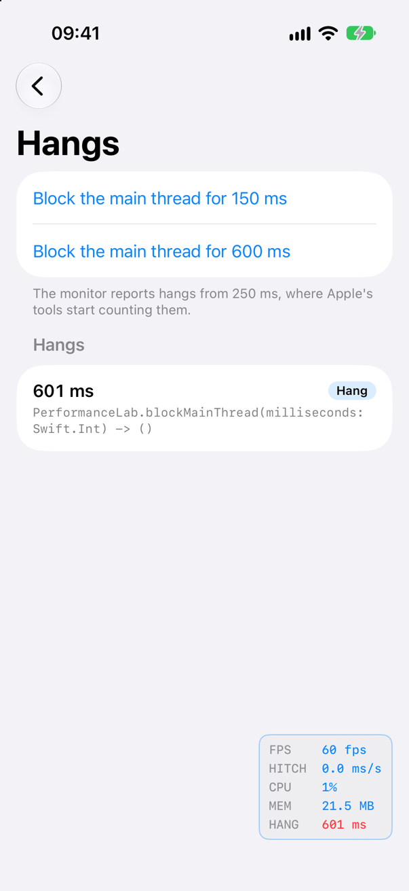
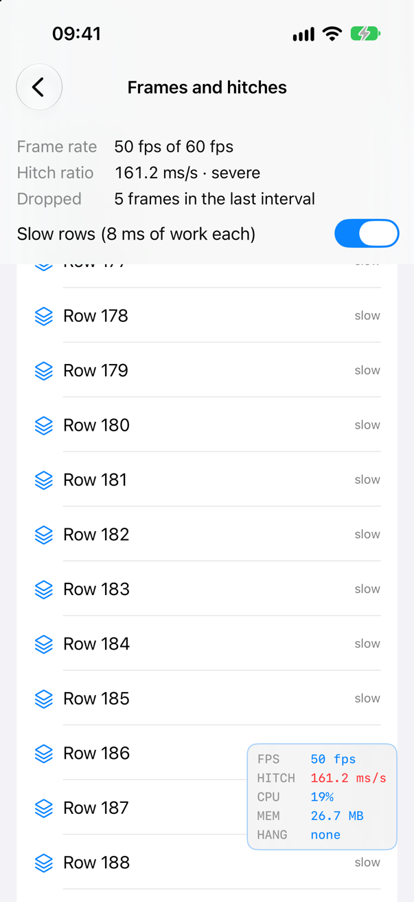
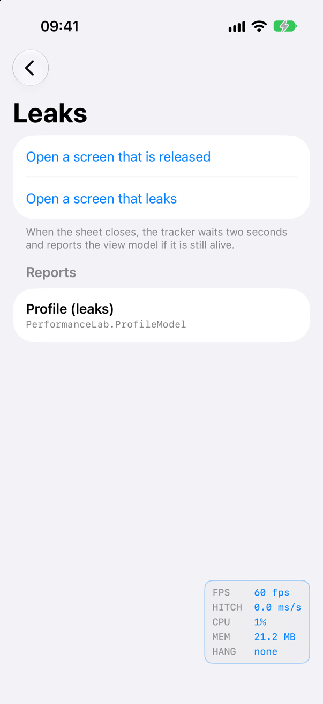
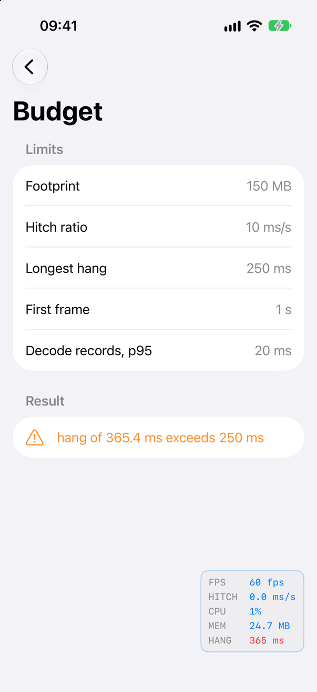

<!-- i18n-source: README.md@7713e35c837f2f5de2312d94c19d1af745744d0e status=reviewed -->
<!-- brand:start -->

<p align="center"><picture><source media="(prefers-color-scheme: dark)" srcset="https://raw.githubusercontent.com/muhittincamdali/iOS-Performance-Optimization-Toolkit/master/.github/brand/banner-dark.svg"><source media="(prefers-color-scheme: light)" srcset="https://raw.githubusercontent.com/muhittincamdali/iOS-Performance-Optimization-Toolkit/master/.github/brand/banner-light.svg"></picture></p>

<!-- lang-selector:start -->
<p align="center"><a href="README.md">English</a> · <a href="README.tr.md">Türkçe</a> · <a href="README.zh-CN.md">简体中文</a> · <a href="README.ja.md">日本語</a> · <a href="README.ko.md">한국어</a> · <a href="README.es.md">Español</a> · <a href="README.de.md">Deutsch</a> · <a href="README.fr.md">Français</a> · <a href="README.pt-BR.md">Português (Brasil)</a> · <a href="README.ru.md">Русский</a></p>
<!-- lang-selector:end -->

<p align="center">
<a href="https://github.com/muhittincamdali/iOS-Performance-Optimization-Toolkit/actions/workflows/ci.yml"></a>
<a href="https://github.com/muhittincamdali/iOS-Performance-Optimization-Toolkit/releases"><picture><source media="(prefers-color-scheme: dark)" srcset="https://raw.githubusercontent.com/muhittincamdali/iOS-Performance-Optimization-Toolkit/master/.github/brand/badge-version-dark.svg"><source media="(prefers-color-scheme: light)" srcset="https://raw.githubusercontent.com/muhittincamdali/iOS-Performance-Optimization-Toolkit/master/.github/brand/badge-version-light.svg"></picture></a>
<a href="https://github.com/muhittincamdali/iOS-Performance-Optimization-Toolkit/blob/master/Package.swift"><picture><source media="(prefers-color-scheme: dark)" srcset="https://raw.githubusercontent.com/muhittincamdali/iOS-Performance-Optimization-Toolkit/master/.github/brand/badge-platforms-dark.svg"><source media="(prefers-color-scheme: light)" srcset="https://raw.githubusercontent.com/muhittincamdali/iOS-Performance-Optimization-Toolkit/master/.github/brand/badge-platforms-light.svg"></picture></a>
<a href="https://github.com/muhittincamdali/iOS-Performance-Optimization-Toolkit/blob/master/Package.swift"><picture><source media="(prefers-color-scheme: dark)" srcset="https://raw.githubusercontent.com/muhittincamdali/iOS-Performance-Optimization-Toolkit/master/.github/brand/badge-language-dark.svg"><source media="(prefers-color-scheme: light)" srcset="https://raw.githubusercontent.com/muhittincamdali/iOS-Performance-Optimization-Toolkit/master/.github/brand/badge-language-light.svg"></picture></a>
<a href="https://github.com/muhittincamdali/iOS-Performance-Optimization-Toolkit/blob/master/LICENSE"><picture><source media="(prefers-color-scheme: dark)" srcset="https://raw.githubusercontent.com/muhittincamdali/iOS-Performance-Optimization-Toolkit/master/.github/brand/badge-license-dark.svg"><source media="(prefers-color-scheme: light)" srcset="https://raw.githubusercontent.com/muhittincamdali/iOS-Performance-Optimization-Toolkit/master/.github/brand/badge-license-light.svg"></picture></a>
</p>

<p align="center">
<a href="#início-rápido"><picture><source media="(prefers-color-scheme: dark)" srcset="https://raw.githubusercontent.com/muhittincamdali/iOS-Performance-Optimization-Toolkit/master/.github/brand/button-start-pt-BR-dark.svg"><source media="(prefers-color-scheme: light)" srcset="https://raw.githubusercontent.com/muhittincamdali/iOS-Performance-Optimization-Toolkit/master/.github/brand/button-start-pt-BR-light.svg"></picture></a>
<a href="https://muhittincamdali.github.io/iOS-Performance-Optimization-Toolkit/documentation/performanceoptimizationkit/"><picture><source media="(prefers-color-scheme: dark)" srcset="https://raw.githubusercontent.com/muhittincamdali/iOS-Performance-Optimization-Toolkit/master/.github/brand/button-docs-pt-BR-dark.svg"><source media="(prefers-color-scheme: light)" srcset="https://raw.githubusercontent.com/muhittincamdali/iOS-Performance-Optimization-Toolkit/master/.github/brand/button-docs-pt-BR-light.svg"></picture></a>
<a href="https://github.com/muhittincamdali/iOS-Performance-Optimization-Toolkit/tree/master/Examples"><picture><source media="(prefers-color-scheme: dark)" srcset="https://raw.githubusercontent.com/muhittincamdali/iOS-Performance-Optimization-Toolkit/master/.github/brand/button-examples-pt-BR-dark.svg"><source media="(prefers-color-scheme: light)" srcset="https://raw.githubusercontent.com/muhittincamdali/iOS-Performance-Optimization-Toolkit/master/.github/brand/button-examples-pt-BR-light.svg"></picture></a>
</p>

> Esta é uma tradução do README em inglês. Se houver diferença, vale a versão em inglês.

<!-- brand:end -->

Um pacote Swift que mede o que faz um app parecer lento, em iOS 17+, macOS 14+, tvOS 17+, watchOS 10+ e visionOS 1+, sem dependências. Ele reporta travamentos (hangs) da thread principal junto com a pilha de chamadas que os causou, quadros atrasados como o hitch time ratio da Apple, a pegada de memória (memory footprint) que o sistema compara com o limite do seu app, o tempo de abertura desde o momento em que o processo começou e os view models que sobrevivem à própria tela. Os mesmos números chegam dos dispositivos das pessoas por meio do MetricKit, e um orçamento (budget) transforma qualquer um deles em um teste que falha.

## Destaques

- **Travamentos com pilha de chamadas** — o `HangDetector` avisa quando a thread principal fica 250 ms ou mais sem responder e, enquanto ela ainda está bloqueada, registra sua pilha de chamadas com nomes Swift demangled.
- **Hitches do jeito que a Apple conta** — o `FrameTimeline` mede quanto cada quadro está atrasado e informa o hitch time ratio em ms/s, classificado com os limites da documentação da Apple.
- **O número de memória que importa** — o `MemorySnapshot` lê a pegada física que o sistema impõe, o seu pico e, em dispositivos, a memória que resta antes do limite.
- **Abertura e vazamentos** — o `LaunchTimer` mede desde a criação do processo (antes de `main`) e reconhece aberturas pré-aquecidas (prewarmed); o `LeakTracker` informa os objetos que continuam vivos depois que a tela deles foi fechada.
- **Dados de campo e orçamentos** — o `FieldMetricsReceiver` lê os relatórios diários do MetricKit no iOS 17 a 27; o `PerformanceBudget` verifica qualquer medição contra limites em um teste.
- **Feito para rodar o dia todo** — todo buffer tem um limite, valores vindos do kernel ou de um payload são verificados antes do uso, e as medições de rede não guardam cabeçalhos nem corpos, apenas uma URL ocultada. 122 testes do Swift Testing rodam no macOS, 121 deles também em um simulador de iPhone, contra travamentos, alocações e requisições HTTP reais.

### O que está incluído

| Área            | API                                                                     |
| --------------- | ----------------------------------------------------------------------- |
| Overlay ao vivo | `PerformanceMonitor`, `PerformanceHUD`, `PerformanceSnapshot`           |
| Travamentos     | `HangDetector`, `HangEvent`, `HangSeverity`, `StackFrame`               |
| Quadros         | `FrameRateMonitor`, `FrameTimeline`, `FrameStatistics`, `HitchRating`   |
| Memória e CPU   | `MemorySnapshot`, `CPUSnapshot`, `ProcessCPUTime`                       |
| Abertura        | `LaunchTimer`, `LaunchMeasurement`, `ProcessLaunch`, `measuresLaunch()` |
| Vazamentos      | `LeakTracker`, `LeakReport`                                             |
| Operações       | `PerformanceTracer` (signposts para o Instruments), `SampleStatistics`  |
| Rede            | `NetworkMetricsCollector`, `NetworkTiming`, `URLRedaction`              |
| Dados de campo  | `FieldMetricsReceiver`, `FieldMetrics`, `FieldHistogram`                |
| Orçamentos      | `PerformanceBudget`, `PerformanceMeasurements`, `BudgetViolation`       |

## Início rápido

**1. Adicione o pacote**

No Xcode, escolha **File › Add Package Dependencies…** e informe a URL do repositório:

```text
https://github.com/muhittincamdali/iOS-Performance-Optimization-Toolkit.git
```

Cole-a no campo de busca no canto superior direito da janela. Deixe **Dependency Rule** em **Up to Next Major Version** a partir de `2.0.0` e clique em **Add Package**. Na janela seguinte, escolha o target do seu app ao lado de **PerformanceOptimizationKit** e clique em **Add Package** de novo.

**2. Importe o módulo**

```swift
import PerformanceOptimizationKit
```

**3. Mostre o overlay**

Envolva sua primeira view em uma view que inicie um `PerformanceMonitor` e mostre o `PerformanceHUD` dele:

```swift
struct RootView: View {
    @State private var monitor = PerformanceMonitor()

    var body: some View {
        ContentView()
            .overlay(alignment: .topTrailing) {
                PerformanceHUD(monitor: monitor).padding()
            }
            .task { monitor.start() }
    }
}
```

Mostre `RootView()` no lugar de `ContentView()` no seu `App` e execute o app: o overlay no canto superior direito mostra a taxa de quadros, o hitch ratio, a CPU, a memória e o último travamento, e é atualizado a cada segundo. O monitor de quadros mantém a tela na taxa de atualização máxima, então mostre o overlay somente em builds de debug (`#if DEBUG`).

## Instalação

### Swift Package Manager

No Xcode, escolha **File › Add Package Dependencies…** e informe a URL do repositório:

```text
https://github.com/muhittincamdali/iOS-Performance-Optimization-Toolkit.git
```

Ou adicione-o às `dependencies` do seu `Package.swift`:

```swift
dependencies: [
    .package(url: "https://github.com/muhittincamdali/iOS-Performance-Optimization-Toolkit.git", from: "2.0.0")
],
targets: [
    .target(name: "YourApp", dependencies: [
        .product(name: "PerformanceOptimizationKit", package: "iOS-Performance-Optimization-Toolkit")
    ])
]
```

Use a versão 2.0.0 ou posterior: a versão 1.0.0 não compilava, e a 2.0.0 substitui a API dela.

## Uso

### Descubra o que bloqueia a thread principal

```swift
func watchForHangs() {
    let detector = HangDetector(capturesBacktraces: true)
    detector.start()
    Task {
        for await hang in detector.events() {
            print("Main thread blocked for \(hang.duration)")
            for frame in hang.backtrace?.prefix(5) ?? [] {
                print("  \(frame.image ?? "?")  \(frame.symbol ?? "?")")
            }
        }
    }
}
```

Os quadros (frames) mais internos mostram o que a thread principal estava executando quando o travamento chegou a 250 ms. Em um build de release sem símbolos, os frames trazem endereços e nomes de binários; simbolize-os com o dSYM.

### Meça a abertura

```swift
struct LaunchSampleApp: View {
    var body: some View {
        ContentView()
            .measuresLaunch()
            .task {
                let launch = LaunchTimer.markInteractive()
                if !launch.wasPrewarmed, let firstFrame = launch.timeToFirstFrame {
                    print("First frame after \(firstFrame)")
                }
            }
    }
}
```

O tempo começa quando o kernel criou o processo, então inclui o dynamic linker e os inicializadores estáticos anteriores a `main`. Um processo pré-aquecido ficou esperando suspenso antes de a pessoa abrir o app; `wasPrewarmed` indica que você deve deixar essa abertura de fora.

### Verifique um orçamento

```swift
@MainActor
func checkBudget(of monitor: PerformanceMonitor) {
    let budget = PerformanceBudget(
        maximumFootprintBytes: 200 * 1_048_576,
        maximumHitchTimeRatio: HitchRating.goodLimit,
        maximumHangDuration: .milliseconds(250)
    )
    for violation in budget.evaluate(monitor.measurements) {
        print("Over budget: \(violation)")
    }
}
```

Cada violação aparece como `hang of 900 ms exceeds 250 ms`. Em um teste unitário, passe as estatísticas do `PerformanceTracer` e verifique `#expect(violations.isEmpty)`; o [artigo sobre orçamentos](https://muhittincamdali.github.io/iOS-Performance-Optimization-Toolkit/documentation/performanceoptimizationkit/settingperformancebudgets) mostra como.

### Leia dados de campo do MetricKit

```swift
let fieldMetrics = FieldMetricsReceiver()

func receiveFieldMetrics() {
    fieldMetrics.start()
    Task {
        for await metrics in fieldMetrics.updates() {
            if let launches = metrics.timeToFirstDraw, let median = launches.percentile(0.5) {
                print("Median launch: \(median) s over \(launches.totalCount) launches")
            }
        }
    }
}
```

O MetricKit entrega um relatório cerca de uma vez por dia a partir de dispositivos cujos donos compartilham dados de análise com os desenvolvedores. `FieldMetrics` é `Codable` e não depende do MetricKit, então você pode enviá-lo e decodificá-lo em um servidor. No iOS 27 e no macOS 27, o receiver usa o novo `MetricManager`; em sistemas anteriores, o `MXMetricManager`.

### Meça o tempo das requisições de rede

```swift
let networkTimings = NetworkMetricsCollector(redaction: URLRedaction(allowedQueryParameters: ["page"]))

func loadOrders(page: Int) async throws -> Data {
    let url = URL(string: "https://api.example.com/v1/orders?page=\(page)")!
    let (data, _) = try await URLSession.shared.data(from: url, delegate: networkTimings)
    return data
}

func logSlowRequests() {
    Task {
        for await timing in networkTimings.updates() {
            if let waiting = timing.phases.waiting, waiting > .milliseconds(500) {
                print("\(timing.url) waited \(waiting) for the server")
            }
        }
    }
}
```

Cada `NetworkTiming` divide a requisição em consulta de DNS, conexão, TLS, envio, espera pelo primeiro byte e recebimento. A URL é ocultada antes de ser armazenada: `https://api.example.com/v1/users/48213/orders?page=2&token=abc` é registrada como `https://api.example.com/v1/users/:id/orders?page=2`.

## O que é registrado

O pacote é pensado para builds internos e beta usados por pessoas reais, então seus relatórios não podem carregar os dados dessas pessoas.

- **Registrado:** durações, números de quadros e hitches, números de memória e CPU, pilhas de chamadas da thread principal durante um travamento (nomes de binários e de símbolos), os números do MetricKit e o build do app, os nomes de tipo dos objetos que sobrevivem à sua tela e, de cada requisição, a URL ocultada, o método, o código de status, o protocolo, a duração de cada fase e o tamanho da resposta. Os nomes que você passa ao `PerformanceTracer` e ao `LeakTracker` são registrados como você os dá, então use nomes fixos.
- **Nunca registrado:** cabeçalhos de requisição e de resposta (`Authorization`, cookies), corpos de requisição e de resposta, o nome de usuário e a senha e o fragmento de uma URL, e a query dela, exceto os parâmetros que você permitir pelo nome.
- **URLs:** segmentos do caminho que parecem identificadores (números, UUIDs, endereços de e-mail, seis ou mais dígitos, números de cartão, IBANs, tokens) viram `:id`, assim como o segmento depois de um nome como `token` ou `password`. Um segmento que não é ASCII puro depois da decodificação de porcentagem, como `Şifre` ou uma palavra com uma letra parecida de outro alfabeto, é ocultado junto com o seguinte, de propósito. Um caminho que servidores poderiam ler de maneiras diferentes (`..`, `;`, codificação de porcentagem dupla) é registrado apenas como esquema e host.

A ocultação é uma rede de segurança, não uma garantia. Ela não consegue saber que uma palavra comum em um caminho, como o código de convite `sunflower`, é secreta. Mantenha segredos fora das URLs, ou registre só o host com `URLRedaction(recordsHostOnly: true)`. O [artigo sobre as medições de rede](https://muhittincamdali.github.io/iOS-Performance-Optimization-Toolkit/documentation/performanceoptimizationkit/recordingnetworktimings) lista todas as regras e seus limites.

## App de exemplo

[`Examples/PerformanceLab`](Examples/) é um app para iOS e macOS que causa cada problema de propósito para que você veja a medição reagir. Da esquerda para a direita: um travamento de 600 ms da thread principal, com a função do app para a qual a pilha de chamadas aponta; uma lista com linhas lentas rolada na velocidade máxima; um view model mantido vivo por um closure; e uma verificação de orçamento que detecta um travamento.

<p align="center">
<picture><source media="(prefers-color-scheme: dark)" srcset="docs/images/example-hangs-dark.png"></picture>
<picture><source media="(prefers-color-scheme: dark)" srcset="docs/images/example-frames-dark.png"></picture>
<picture><source media="(prefers-color-scheme: dark)" srcset="docs/images/example-leaks-dark.png"></picture>
<picture><source media="(prefers-color-scheme: dark)" srcset="docs/images/example-budget-dark.png"></picture>
</p>

As capturas de tela são feitas a partir do app em execução em um simulador de iPhone por [`scripts/capture-example-screens.sh`](scripts/capture-example-screens.sh), então os números são medidos, não desenhados.

## Documentação

A [documentação do DocC](https://muhittincamdali.github.io/iOS-Performance-Optimization-Toolkit/documentation/performanceoptimizationkit/) cobre todos os tipos públicos, com estes artigos:

- [Getting Started](https://muhittincamdali.github.io/iOS-Performance-Optimization-Toolkit/documentation/performanceoptimizationkit/gettingstarted)
- [Finding Hangs and Hitches](https://muhittincamdali.github.io/iOS-Performance-Optimization-Toolkit/documentation/performanceoptimizationkit/findinghangsandhitches)
- [Reading Field Metrics](https://muhittincamdali.github.io/iOS-Performance-Optimization-Toolkit/documentation/performanceoptimizationkit/readingfieldmetrics)
- [Setting Performance Budgets](https://muhittincamdali.github.io/iOS-Performance-Optimization-Toolkit/documentation/performanceoptimizationkit/settingperformancebudgets)
- [Recording Network Timings](https://muhittincamdali.github.io/iOS-Performance-Optimization-Toolkit/documentation/performanceoptimizationkit/recordingnetworktimings)

## Requisitos

| Plataforma | Versão mínima |
| ---------- | ------------- |
| iOS        | 17.0          |
| macOS      | 14.0          |
| tvOS       | 17.0          |
| watchOS    | 10.0          |
| visionOS   | 1.0           |

Swift 6.2 ou posterior (Xcode 26 ou posterior). O pacote é compilado no modo de linguagem Swift 6. O monitor de quadros precisa de um display link, então não está disponível no watchOS; o MetricKit não está disponível no tvOS nem no watchOS. As pilhas de chamadas dos travamentos são lidas em arm64 e x86_64, em todas as plataformas, exceto o watchOS, que não permite que um app suspenda as próprias threads.

## Como contribuir

Relatos de bugs e pull requests são bem-vindos; o [CONTRIBUTING.md](CONTRIBUTING.md) explica como compilar, testar e gerar novamente as capturas de tela. Para relatar um problema de segurança de forma privada, consulte o [SECURITY.md](SECURITY.md).

## Licença

MIT. Veja [LICENSE](LICENSE).
